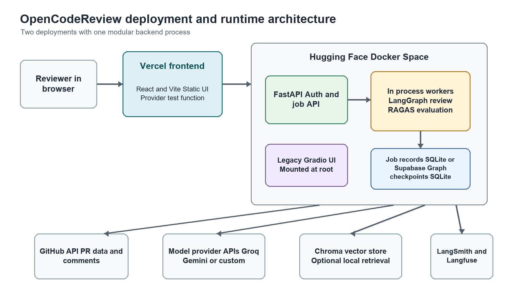
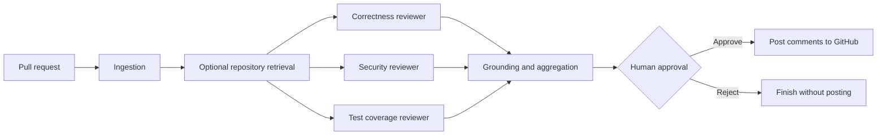

# OpenCodeReview

<p align="center">
  <strong>AI-assisted pull request review, with a person in control of every post.</strong><br />
  Focused reviewers analyze code changes, explain evidence, and wait for approval before comments go to GitHub.
</p>

<p align="center">
  
  
  
  
</p>

OpenCodeReview is a GitHub pull request reviewer built around a simple rule: **AI proposes; a human decides what gets posted.** A FastAPI service starts a LangGraph review, specialist agents examine the change, and a reviewer can inspect the evidence before approving GitHub comments.

## What it does

- Reviews **correctness, security, and test coverage** with separate specialist steps that can run in parallel.
- Retrieves relevant context from selected repository files when optional RAG is enabled.
- Returns structured findings with locations, evidence status, severity, and suggested fixes.
- Makes incomplete reviewer stages visible; a failed stage is never presented as proof that code is safe.
- Pauses for human approval before the executor posts findings to GitHub.
- Includes a React and Vite frontend, a CLI, a FastAPI API, and an optional Gradio interface.

## System architecture



The review graph is:



The API persists job records in Supabase Postgres when configured and otherwise uses SQLite. LangGraph checkpoints use a separate SQLite saver. The current worker and some session state are process-local, so horizontal scaling needs a durable queue and shared runtime state.

## How a review works

1. **Submit a repository and pull request.** The frontend sends the job to FastAPI; GitHub credentials are resolved from the configured environment or OS keyring.
2. **Collect evidence.** Ingestion fetches the pull request metadata, diff, changed files, and base revision.
3. **Find useful context.** If retrieval is enabled, the system builds or reuses a ChromaDB collection for the repository's base revision. It selects supported source, documentation, and configuration files, skips excluded paths, and retrieves up to 15 relevant chunks. Python is split at top-level classes and functions; other supported text is split around paragraphs with a chunk target of about 1,200 characters.
4. **Run focused reviews.** Correctness, security, and test-coverage steps use separate prompts and structured Pydantic outputs, with file and line references when available.
5. **Check and combine findings.** Grounding checks compare findings with the changed lines. Aggregation removes overlap and produces a risk summary. These checks reduce unsupported comments but cannot guarantee that a model's claim is correct.
6. **Ask a person.** The graph pauses so the reviewer can approve or reject the proposed comments.
7. **Post only after approval.** The executor sends approved comments to GitHub and records the result.

## Model and retrieval options

The model factory supports the built-in Groq and Google Gemini providers, plus configured custom endpoints such as OpenAI-compatible APIs and Anthropic. An explicitly selected endpoint is used for that run; otherwise the default path prefers Groq when configured and falls back to Gemini. Built-in provider keys are read from environment variables. GitHub access can use a token or the OAuth Device Flow, which stores its token in the OS keyring.

Retrieval is optional. It uses ChromaDB with local embeddings when enabled; the hosted workflow can continue with the pull request diff when retrieval is disabled or unavailable. The index is selective and revision-aware, rather than a blind copy of every repository file.

## Try it locally

### Requirements

- Python 3.12 or newer
- Node.js and npm, only if you want to run the React frontend
- For real pull requests: GitHub access and at least one supported model provider key

### Install and run the offline smoke review

```powershell
git clone https://github.com/sdm0p/opencodereview.git
cd opencodereview

python -m venv .venv
.venv\Scripts\Activate.ps1
python -m pip install -r requirements.txt

python main.py review --smoke
```

The smoke review uses synthetic input and does not need GitHub or model credentials.

### Review a real pull request

Copy `.env.example` to `.env`, then set a GitHub token and a supported model key. `.env` is ignored by Git; never commit credentials.

```powershell
Copy-Item .env.example .env
# Edit .env, then:
python main.py review --repo OWNER/REPOSITORY --pr 123
```

The CLI supports GitHub OAuth Device Flow as well as token-based access. Run `python main.py --help` or `python main.py auth --help` for the current commands.

### Run the API and frontend

In one terminal from the repository root:

```powershell
uvicorn api:app --reload --port 8000
```

In another terminal:

```powershell
cd frontend
npm ci
# Set VITE_REVIEW_API_URL=http://localhost:8000 in frontend/.env.local
npm run dev
```

The root Python modules are small compatibility shims, so existing launch commands continue to work while the implementation lives in `backend/`.

## Development and evaluation

Run the automated checks with:

```bash
python -m pytest -q
```

The `eval_data/` tools provide an offline scorer against human review comments and a RAGAS evaluation path for retrieval and generation metrics. These tools are evaluation infrastructure, not a claim of a particular quality score. Results depend on the dataset, provider, and run configuration.

## Project map

| Path | Responsibility |
|---|---|
| `backend/` | FastAPI API, CLI, LangGraph construction, typed state, and observability |
| `backend/integrations/` | GitHub access, authentication, settings, model clients, and endpoints |
| `nodes/` | Ingestion, retrieval, specialist reviewers, grounding, approval, and execution |
| `prompts/` | Versioned reviewer and aggregator prompt templates |
| `frontend/` | React and Vite user interface, deployed separately from the Python service |
| `eval_data/`, `tests/` | Offline evaluation data, RAGAS tooling, and automated tests |
| `docs/` | Architecture, runbooks, engineering notes, specification, and interview guide |
| `Dockerfile*`, `docker-compose.yml` | Backend container and local orchestration |
| `.github/workflows/` | Deployment and scheduled alert workflows |

Start with the [documentation index](docs/README.md) or read the [architecture overview](docs/architecture/ARCHITECTURE.md). The editable interview guide and PDF are in [`docs/project-guide/`](docs/project-guide/README.md).

## Current boundaries

- Model output can be wrong. Evidence checks and human approval are safeguards, not guarantees.
- The worker queue and some session data are process-local; production multi-replica use needs shared, durable infrastructure.
- RAG is opt-in and depends on GitHub access, ChromaDB, and embedding availability.
- The evaluation harness is included, but users should run it on their own representative dataset before making quality claims.

## About

OpenCodeReview is a practical AI engineering project for human-reviewed code review. It brings together retrieval, multi-step agent orchestration, structured model output, GitHub integration, and evaluation while keeping the approval boundary visible.

## License

No license file is currently included in this repository.
